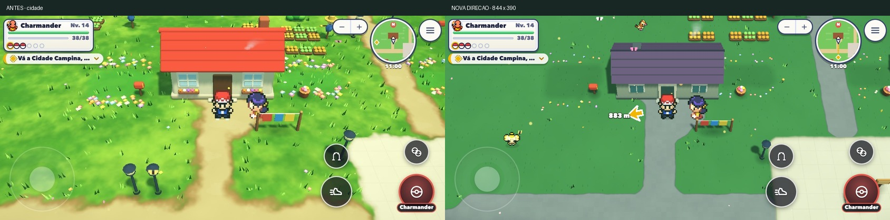
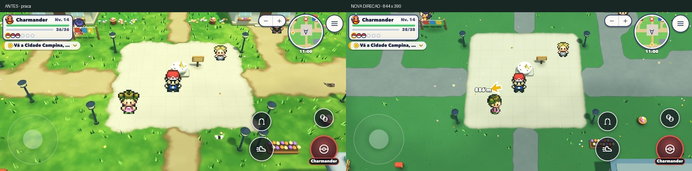
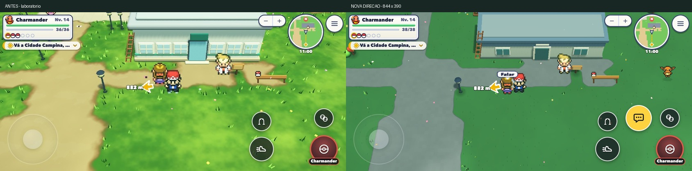
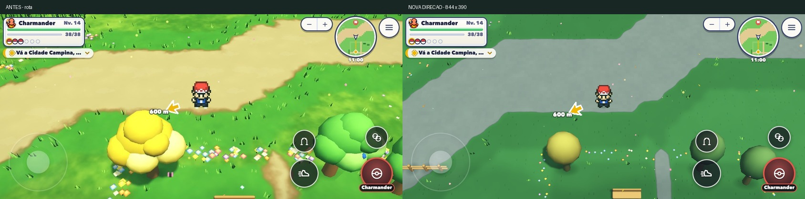

# Direção visual do modelo — RPG 2,5D

Continuação da análise em [referencia-visual.md](referencia-visual.md). A rodada anterior melhorou nitidez, mas conservava os volumes arredondados. Esta rodada altera formas, proporções, perspectiva e materiais em conjunto, na Vila Alvorada e na Rota 1. Os sprites do treinador e dos Pokémon continuam os existentes. É uma interpretação da referência, com modelos próprios, não uma cópia de seus assets nem uma afirmação sobre o motor usado no vídeo.

## Decisões

- Casas com telhado angular, empenas fechadas, fiadas de telha, beirais e caixilhos legíveis; paleta de ardósia, reboco claro e madeira discreta. Laboratório com laje e volumes simples.
- Árvores comuns em andares de conífera, tronco aparente e folhagem mais escura. Ipê e árvores de fruta com copa única; as frutas continuam desaparecendo quando colhidas.
- Chão sem ondulação extra no modelo, gramados com variação contida e pequenos traços de textura; canteiros de grama escura preservam seu contraste. Ruas cinzentas com limite claro, evitando o aspecto de terra brilhante.
- Câmera de exploração a 58°, campo de visão de 22° e perspectiva mais contida. O enquadramento de combate e dos interiores continua próprio desses modos. A mira é calculada pela mesma projeção usada para desenhar.
- Menos flores volumosas e tufos aleatórios; os jardins existentes continuam agrupados. Postes duplicados na mesma esquina da vila foram retirados junto com suas pegadas. Permanecem as quatro luminárias da praça e a do laboratório.
- Na passagem de porta, a projeção é atualizada durante o escuro. Fora de portas, a mudança entre enquadramentos é gradual.

As árvores e prédios novos usam primitivas compartilhadas, cache por tipo e estado e as mesmas malhas mescladas dos setores. Não há novas texturas, GLBs, efeitos de tela inteira ou mudanças no dano, recargas, roteiro e barreiras de progressão. As caixas sem arredondamento usam normais corretas de caixa, e o perfil antigo continua disponível fora do modelo.

## Custo dos modelos

| Modelo | Triângulos anteriores | Novos |
|---|---:|---:|
| Casa | 1.570 | 226 |
| Laboratório | 2.706 | 112 |
| Árvore comum | 296 | 62 |
| Pinheiro | 212 | 62 |
| Ipê | 296 | 94 |
| Oran / Pecha | 368 | 118 |

O teste confere cache compartilhado, atributos finitos, normais, dimensões da pegada e estado de fruta colhida. A auditoria de paredes invisíveis foi atualizada para examinar o perfil que é realmente usado em cada posição do modelo, além do estilo antigo no restante do mundo.

## Capturas

Capturas do jogo em 844×390, às 11h, nos mesmos pontos antes e depois. As diferenças de enquadramento são parte da mudança; moradores e animações podem aparecer em momentos diferentes.

- Cidade: `(1523,1750)`.
- Praça: `(1534,1758)`.
- Laboratório: `(1544,1772)`.
- Rota: `(1240,1750)`.

[Comparação adicional da vegetação com a referência, em locais distintos](../tools/shots/direcao-rpg/arvoredo-referencia.jpg). A composição e a densidade dessa borda ainda não reproduzem as do vídeo.

## Arquivos

| Arquivo | Mudança |
|---|---|
| `src/visual3d/letsgo/modelos-rpg.js` | Casas, salão, coníferas e copas do perfil novo, feitos com primitivas compartilhadas |
| `src/visual3d/letsgo/modelos.js` | Registro de perfis e cache por perfil; caixa simples com normais próprias |
| `src/visual3d/letsgo/modelos-todos.js` | Registra o perfil RPG |
| `src/visual3d/kit/modelos-setor.js` | Seleciona o perfil pela posição, inclusive modelos móveis de árvores frutíferas |
| `src/visual3d/camera.js` | Inclinação e perspectiva do modelo, com transição gradual |
| `src/visual3d/index.js` | Distância e projeção acompanham o campo de visão real |
| `src/visual3d/letsgo/chao.js` | Gramado, ruas, bordas e textura discreta usando o material existente |
| `src/visual3d/letsgo/grama.js` | Vegetação baixa e flores menores no modelo |
| `src/visual3d/letsgo/luz.js` | Luz e sombras mais neutras, sem escurecer adicionalmente a exploração noturna |
| `src/visual3d/letsgo/relevo.js` | Chão plano no modelo; setores totalmente planos evitam calcular ondulação |
| `src/visual3d/setores.js` | Cache menor no toque, preservando sempre os setores visíveis |
| `src/world/piloto-visual.js` | Retira postes redundantes e suas colisões na vila |
| `src/world/life.js` | Ajusta a projeção da câmera enquanto a porta está escura |
| `tools/auditar-invisiveis.mjs` | Examina os modelos novos nas posições onde são usados |
| `tools/teste-modelos-rpg.mjs` | Confere compartilhamento, pegada, atributos, normais e estado de frutas |
| `tools/teste-3d/referencia-exploracao.mjs` | Confere também inclinação, campo de visão, chão plano e ida/volta da mira |
| `tools/teste-3d/referencia-comparar.mjs` | Aceita pares de medições sem sobrescrever a rodada anterior |

## Limites

O padrão não foi espalhado pelo continente nem aplicado aos interiores e ginásios. A distribuição geral das cidades, seus prédios e pontos da campanha continua no lugar; esta rodada não redesenha todas as áreas vazias criadas pela ampliação. A silhueta de Pokémon e treinador continua em pixel art, de modo que o resultado não pretende reproduzir literalmente todos os elementos da referência.

Não houve teste em iPhone físico/Safari. As medições de Chrome com CPU 4× e contagens do renderer são uma comparação controlada, não prova de eliminação dos fechamentos no aparelho. Nada desta rodada foi publicado: trabalho local em `visual-referencia`.

## Desempenho e validação

Comparação com a versão local anterior a esta rodada (`022ea295`). Mesmo percurso automático, três voltas por local, 844×390, DPR 2 e CPU do Chrome 4× mais lenta. O renderer conserva o limite de resolução do toque. P95 e heap após coleta são medianas; picos e contagens são os máximos das três amostras.

| Local | Versão | Quadro p95 (ms) | Lógica CPU p95 (ms) | Pico heap (MB) | Heap após GC (MB) | Geometrias máx. | Texturas máx. |
|---|---|---:|---:|---:|---:|---:|---:|
| Cidade | Antes | 12,20 | 6,80 | 413,33 | 363,09 | 142 | 112 |
| Cidade | Depois | 11,50 | 6,20 | 387,69 | 357,36 | 118 | 103 |
| Rota | Antes | 8,40 | 3,70 | 414,84 | 363,78 | 142 | 112 |
| Rota | Depois | 7,50 | 3,50 | 395,92 | 359,97 | 122 | 106 |

O comparador passou em todos os indicadores, sem tolerância de regressão. Fontes: `tools/resultados/referencia/direcao-antes.json`, `direcao-final-arvores.json` e `comparacao-direcao.json`. As iterações anteriores (`direcao-depois.json` e `direcao-final.json`) foram preservadas: o enquadramento mais afastado aumentava texturas e tempo, e foi corrigido. O cache no toque retém até 22 setores, preservando sempre os que ainda estão visíveis. Não se reduziu a resolução do desenho para obter esses resultados.

As 14 verificações em Node passaram, incluindo jornada completa, guia, caminhada do guia, geografia, vestir e invisíveis. A auditoria com o servidor avaliou 179 NPCs e não encontrou passagem bloqueada. O teste de modelos passou para casas, laboratório, árvores e frutas. O teste no navegador verificou movimento, colisão, câmera estável, campo de visão de 22°, inclinação de 58°, ondulação nula e a correspondência entre a mira na tela e no mundo, além de porta e descarte de setores. Logs e resultados em `tools/resultados/direcao-rpg/`.

O ganho observado de heap é de aproximadamente 4–6 MB nesta rodada; `performance.memory` não inclui toda a memória de GPU. As contagens do renderer caíram, mas não equivalem a bytes de VRAM. O Chrome de teste não limita fps/vsync; seus intervalos não são uma promessa de fps no Safari.

A escala final das árvores foi corrigida para compensar o encurtamento visual da altura na câmera mais alta. O teste final de descarte liberou 47 de 47 geometrias próprias, incluindo uma luz de janela; a porta levou 0,326 s de tempo de jogo e 0,500 s reais nessa execução.
