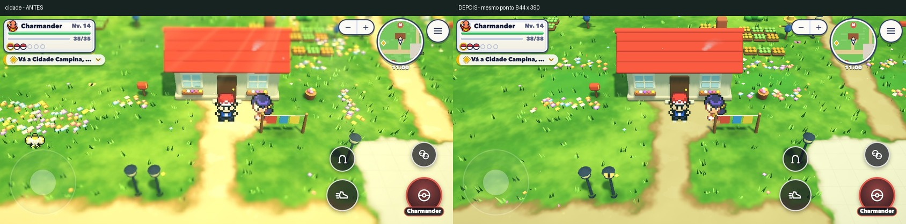
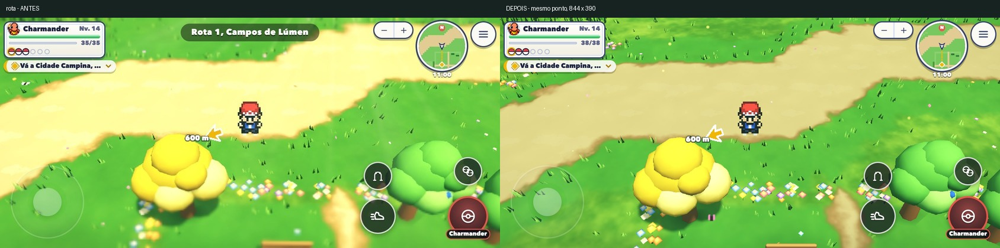

# Referência visual — cidade e rota modelo

## Etapa 1 — análise anterior às mudanças do jogo

Data: 22/10/2026. Base publicada: `57e60497`. Trabalho local no branch `visual-referencia`, sem publicar esta etapa.
Referência: [Pocket Champion, vídeo de GameX Ladka](https://www.youtube.com/watch?v=fxpHNIK1AYw), 9min18s, 1280×720, 60 quadros/s no arquivo. Isso não comprova que o jogo rode a 60 fps.

O vídeo foi baixado com yt-dlp, sem erro 403, para `/Users/matheusparente/Documents/Referencias/alvorada-visual-2026-10-22/`, fora do repositório. Foram extraídos 279 quadros, um a cada dois segundos, e 16 quadros adicionais a 2 fps entre 02:34 e 02:42. Não houve acesso a código da referência. Os cortes muito frequentes desse trecho impedem medir aceleração, latência de comando e tempo real de carregamento. As observações de fluidez são qualitativas.

As comparações em `tools/shots/referencia/` retiram apenas as faixas pretas superior/inferior do vídeo e preservam sua proporção, sem mudar cores. Cada painel do Alvorada mede 844×390. Os interiores comparados têm função equivalente, sem pretensão de reproduzir sua planta. A imagem de mata usa a borda arborizada da rota: o vídeo não oferece uma exploração equivalente ao nosso bosque denso. A água visível é um pequeno lago urbano; não permite avaliar rios, espuma ou navegação.

## O que a referência faz melhor

### Visual

- **00:20 e 08:40 — cidade e lago:** piso cinza separado do gramado, telhados com volumes reconhecíveis, sombras sob árvores e beirais. O azul da água se distingue do verde. O Alvorada tem água animada e sombras, mas as estradas ficam amarelas quase brancas, árvores também amarelam e o brilho compete com as portas.
- **06:10–06:20 e 07:20 — rota e borda de mata:** caminho contínuo legível, vegetação alta concentrada em canteiros e árvores fechando a composição. O Alvorada tem setores de mata e LOD, porém flores e pequenos enfeites repetidos atravessam áreas sem função. Não precisamos copiar as árvores como modelos: precisamos organizar as existentes.
- **08:10 — Centro Pokémon; 09:10 — casa:** balcão, entrada e circulação identificáveis; móveis apoiados no piso e contraste entre parede e chão. Nossos interiores já têm esses elementos, mas o desfoque e a luz forte reduzem a leitura dos detalhes.
- **01:30 — arena:** piso amplo e poucos volumes no centro; os lutadores ganham contraste. Nossa arena já tem espaço amplo. Nesta rodada não se altera batalha, puzzle ou equilíbrio.
- **Céu, escala e contorno:** na exploração a referência usa enquadramento alto e quase não mostra céu. A identidade dos lugares vem do chão, dos prédios e das bordas. Os personagens contrastam com o piso. Não há evidência para justificar um céu novo, texturas maiores ou contorno de tela inteira no Alvorada.

### Fluidez

- **06:10–06:20 e 07:18–07:30:** câmera mantém orientação e distância previsíveis enquanto o personagem atravessa a rota. A sequência sugere acompanhamento estável. No Alvorada há amortecimento, mas giro automático e aproximação ao ficar parado deslocam os pontos de referência sem uma ação do jogador.
- **02:34–02:42:** os quadros adicionais mostram ciclos de caminhada e acompanhamento, mas também cortes e reposicionamentos da edição. Não é possível extrair uma curva de aceleração confiável. Nosso movimento clássico começa e termina com velocidade constante; o livre já tem amortecimento.
- **07:32 e 08:04–08:08:** há telas escuras/transições. Sua duração não deve ser interpretada como tempo de carga por causa dos cortes. No Alvorada podemos medir a transição implementada: porta usa 0,22 s para escurecer e 0,28 s para reaparecer. É possível encurtar o fade sem encurtar a proteção contra reentrada.

### Organização do cenário

- **00:20, 08:20 e 09:00:** frente dos prédios limpa e ligada diretamente à rua; jardins em ilhas, árvores na borda e telhados como marcos. O laboratório é reconhecível por forma e posição, sem depender de uma seta.
- **06:10–06:20:** caminho principal contínuo; mato de encontro ao lado, em massas. O vazio no centro serve à circulação. A nossa ampliação mantém travessias longas, mas repete módulos de flores em áreas abertas; espalhar mais objetos agravaria isso.
- **07:20:** borda de coníferas conduz à cidade. Reaproveitar bordas existentes é mais seguro que acrescentar sólidos: conserva as rotas do guia e não cria paredes invisíveis.
- A interface da referência é carregada de chat, nomes e avisos. Isso não é um objetivo visual desta rodada.

## Inventário

| Item | Já existe | Falta / decisão |
|---|---|---|
| Luz e paleta por bioma | Sol, hemisfério, dia/noite, climas | Reduzir amarelo e brilho, preservar identidade dos biomas |
| Sombras | Sombra de contato e volumes | Ganhar leitura com gradação, sem mapa de sombra maior |
| Céu | Céu procedural e horizonte | Manter; não é a principal diferença observada |
| Água | Material animado e margens | Lago da referência é evidência limitada; não refazer água |
| Vegetação | Árvores LOD, grama e sub-bosque | Agrupar no piloto e retirar ruído do eixo principal |
| Personagens e contorno | Sprites PMD e sombras | Manter resolução e retirar desfoque que reduz leitura |
| Caminho principal | Trilhas ampliadas e acessos | Tornar bordas e canteiros intencionais no piloto |
| Frentes de prédios | Portas e alamedas | Faixa visual limpa; não mover porta ou destino |
| Movimento | Grade e movimento livre | Entrada/saída suave na exploração, sem alterar combate |
| Câmera | Amortecimento, enquadramento e oclusão | Tirar deriva e zoom ocioso; preservar câmera de combate |
| Portas | Fade e reposicionamento | Fade mais rápido, enquadrar durante o escuro |
| Memória por setor | Montagem e descarte 3D | Evitar metadados vazios do mundo inteiro; conferir descarte de janelas |
| Pós-processamento | Pirâmide HDR e raios | No celular, usar composição simples já existente, sem buffers extras |

## Oito mudanças em ordem de impacto

| Ordem | Mudança | Arquivos previstos | Porte | Custo no iPhone |
|---|---|---|---|---|
| 1 | Imagem nítida e paleta menos estourada usando o pós simples no toque | `visual3d/ambiente/pos.js`, `visual3d/letsgo/luz.js` | M | Reduz passes e buffers; sem textura nova |
| 2 | Setores vazios sob demanda e descarte de luz de janela | `world/map.js`, `visual3d/setores.js` | M | Reduz heap e evita retenção de geometria |
| 3 | Cidade piloto: frentes limpas e jardins nas bordas | `world/paisagem.js`, `world/build.js` | M | Reaproveita terreno; sem novos sólidos ou malhas |
| 4 | Rota piloto: canteiros ligados às bordas e eixo principal livre | `world/paisagem.js` | M | Menos ruído; quantidade de objetos não aumenta |
| 5 | Câmera estável ao parar e ao caminhar | `visual3d/camera.js` | P | Mesmo número de consultas, menos oscilação |
| 6 | Aceleração/frenagem da exploração clássica | `world/grade.js` | M | Conta escalar por quadro; Pokémon em combate preservado |
| 7 | Porta rápida e câmera assentada no escuro | `world/life.js` | P | Sem recursos adicionais |
| 8 | Aplicar composição ao restante do continente | futuras receitas por região | G | Adiado até comprovar o piloto; sem preenchimento indiscriminado |

## Medição inicial

Chrome sem interface com GPU Metal, CPU limitada em 4×, viewport 844×390, DPR do dispositivo 2 (o renderizador mantém seu limite de resolução de toque). `chrome.mjs` desliga vsync/limite de quadros: os intervalos medem capacidade deste teste, não prometem fps de iPhone. Qualidade alta nas seis amostras. Mesma sequência de quatro comandos de 1,5 s, três voltas alternando cidade/rota, aquecimento de ambas antes da primeira amostra. Os selvagens são retirados e o roteiro suspenso somente no teste para isolar exploração. Os resultados brutos e distância realmente percorrida estão em `tools/resultados/referencia/antes.json`.

| Local | p95 quadro (ms) | p95 lógica CPU (ms) | Pico heap (MB) | Heap após GC (MB) | Geometrias | Texturas |
|---|---:|---:|---:|---:|---:|---:|
| Cidade — antes | 14,00 | 7,20 | 405,94 | 374,61 | 149 | 127 |
| Rota — antes | 10,00 | 6,10 | 404,23 | 375,15 | 149 | 127 |

Valores são medianas das três amostras de cada lugar. `performance.memory` mede heap JS, não toda a memória do processo ou GPU; `renderer.info` informa contagens, não bytes de VRAM. Não equivale a uma medição em Safari/iPhone físico. A tabela final deve manter ou reduzir cada indicador de desempenho e memória; regressão exige ajuste antes da entrega.

## Etapa 2 — resultado do modelo

A composição ficou restrita à Vila Alvorada e à Rota 1. A vila ganhou canteiros junto às fachadas e gramado contínuo na circulação; a rota perdeu a repetição de manchas floridas no terreno inteiro e ganhou pequenos trechos floridos junto à estrada. Mato de encontros, objetos sólidos, portas, destinos e pontos da história foram preservados. A terra ficou mais neutra e com menos manchas claras. A primeira versão dos canteiros estava carregada; a captura levou à redução da faixa de flores antes de fechar o modelo.

No piloto, a câmera conserva orientação e escala ao parar, mantendo o amortecimento e a resposta à oclusão. O treinador ganha velocidade nos primeiros 90 ms e amortece a conclusão do último passo, sem frear a cada bloco. Essa mudança não é aplicada a Pokémon em combate, atores ou montarias. A porta usa fade de 0,14 + 0,18 s e reposiciona a câmera no escuro; a proteção de reentrada continua em 0,5 s.

No celular, o pós simples existente substitui os passes de redução e raios; cinco render targets deixam de ser criados. O mapa não aloca mais metadados para todos os setores vazios do continente. O descarte 3D também libera a geometria da luz de janela, que antes só era liberada ao refazer o setor.

### Capturas e comparações

Todas as capturas normalizadas do jogo têm 844×390. Os pontos do modelo são os mesmos antes/depois: cidade `(1523,1750)` e rota `(1240,1750)`, às 11h. Há animações e moradores em movimento; os atributos aleatórios do Pokémon inicial do modo de teste não foram usados como medida de equilíbrio.

- [Cidade — referência e versão anterior](../tools/shots/referencia/cidade.jpg)
- [Rota — referência e versão anterior](../tools/shots/referencia/rota.jpg)
- [Mata — trecho de rota arborizada e caminho do bosque](../tools/shots/referencia/mata.jpg)
- [Margem — lago da referência e margem do Alvorada](../tools/shots/referencia/margem.jpg)
- [Interior de casa](../tools/shots/referencia/casa.jpg)
- [Centro Pokémon](../tools/shots/referencia/centro.jpg)
- [Ginásio / arena](../tools/shots/referencia/ginasio.jpg)

### Desempenho final — antes × depois

Mesmo roteiro de comandos e configuração da medição inicial, três voltas alternadas por local. A medição final foi feita após terminar os testes pesados em Node. As distâncias efetivas estão nos JSON; colisões e moradores podem alterar o deslocamento, por isso também se registra a distância e se exige caminhada real. Não se promete repetição pixel a pixel de NPCs aleatórios.

Nesta tabela, p95 e heap após GC são medianas das três amostras; **pico de heap e contagens de recursos são os máximos** das três, mais conservadores que a mediana da tabela inicial. O comparador reprova qualquer aumento, sem tolerância percentual.

| Local | Versão | p95 quadro (ms) | p95 lógica CPU (ms) | Pico heap (MB) | Heap após GC (MB) | Geometrias máx. | Texturas máx. |
|---|---|---:|---:|---:|---:|---:|---:|
| Cidade | Antes | 14,00 | 7,20 | 408,75 | 374,61 | 151 | 128 |
| Cidade | Depois | 11,60 | 6,30 | 396,31 | 362,01 | 140 | 111 |
| Rota | Antes | 10,00 | 6,10 | 408,30 | 375,15 | 151 | 128 |
| Rota | Depois | 8,40 | 4,20 | 402,96 | 363,49 | 140 | 111 |

Nenhum dos indicadores aumentou. Fontes: `tools/resultados/referencia/antes.json`, `depois.json` e `comparacao.json`. A amostra intermediária foi preservada em `intermediario.json`; não representa o modelo final. Repetir: `node tools/teste-3d/referencia-desempenho.mjs depois` e `node tools/teste-3d/referencia-comparar.mjs`.

### Validação

As 14 verificações solicitadas em Node passaram: dados, jornada, jornada completa, progressão, alvos/passos, guia, caminhada do guia, sólidos, saídas, falantes, obtenção, invisíveis, geografia e vestir `--verificar`. Logs individuais e códigos de saída em `tools/resultados/referencia/`.

- `auditar-invisiveis`: **0 achados** nos dois mundos.
- `PORTA=8700 node tools/auditar-passagens-npc.mjs`: **179 NPCs, nenhum fecha passagem**.
- `referencia-exploracao.mjs`: aceleração intermediária, parada no centro do bloco, nenhuma posição sólida no percurso, orientação e zoom estáveis ao parar, porta chegando ao Centro, shaders sem erro e pós sem buffers de redução no toque.
- Descarte: **70 geometrias próprias liberadas de 70**, incluindo **uma luz de janela real**; o mundo deixou **50.832 setores sem metadados vazios alocados** nessa sessão.
- Porta na execução final: **0,331 s de tempo de jogo / 0,507 s reais**, incluindo montagem da sala. Uma execução anterior com outras auditorias em andamento levou 0,989 s reais: o fade mais curto não elimina custo de primeira montagem ou contenção da máquina.
- Comparador de desempenho: passou nos seis indicadores de cada local.

Chrome sem interface usa `chrome.mjs` e `--mute-audio`; as medições finais foram isoladas. Os navegadores de teste foram encerrados; o Chrome pessoal não foi encerrado. Não foi necessário executar novamente testes de equilíbrio porque não houve edição de lógica de combate, recargas, dano ou dados de Pokémon.

### Mudanças por arquivo

| Arquivo | Resultado |
|---|---|
| `src/world/piloto-visual.js` | Recorte do modelo, jardins da vila e faixas de vegetação da rota, apenas com terrenos transitáveis |
| `src/world/build.js` | Aplica a composição depois da montagem do núcleo |
| `src/visual3d/letsgo/chao.js` | Terra mais neutra no modelo e menos manchas claras, com máscaras existentes |
| `src/visual3d/letsgo/luz.js` | Luz menos amarela, exposição menor e nitidez do modelo; mistura gradual ao entrar/sair |
| `src/visual3d/camera.js` | Remove giro ocioso e variação de escala na exploração do modelo |
| `src/world/grade.js` | Aceleração e conclusão suave do último passo do treinador explorando |
| `src/world/life.js` | Porta mais rápida e reinicialização do foco da câmera no escuro |
| `src/world/map.js` | Metadados dos setores criados sob demanda, com acesso seguro em edição e movimento de objetos |
| `src/world/masmorra.js` | Compatibilidade de objetos móveis com setores ainda não alocados |
| `src/visual3d/ambiente/pos.js` | Composição simples no toque, sem criar pirâmide e alvo radial |
| `src/visual3d/setores.js` | Libera também a geometria de luz das janelas ao descartar um setor |
| `tools/teste-3d/referencia-desempenho.mjs` | Percurso antes/depois com CPU 4×, heap e recursos |
| `tools/teste-3d/referencia-comparar.mjs` | Reprova regressão dos indicadores definidos |
| `tools/teste-3d/referencia-exploracao.mjs` | Verifica controle, câmera, porta, colisão e descarte no navegador |
| `tools/shots/referencia/` | Sete comparações com vídeo e fotos antes/depois do modelo |
| `tools/resultados/referencia/` | Medições, auditorias e resultados reproduzíveis |

### Próxima rodada e limites

Não foi espalhado o novo desenho pelo restante do continente. O modelo melhorou nitidez e hierarquia, mas uma revisão de composição das outras cidades exige trabalhar seus marcos e caminhos individualmente. Também ficaram de fora uma reformulação de mata densa, água, céu, interiores e ginásios; as imagens desses lugares nesta etapa são comparações diagnósticas. A referência não permite medir carregamento real, aceleração exata ou desempenho do jogo filmado.

Não houve teste em iPhone físico/Safari nem medição dos bytes totais de GPU. A redução observada no Chrome é evidência de melhora, não prova de que o fechamento do aplicativo por memória foi eliminado. Permanece necessário um teste longo no aparelho que apresentava o problema.

A revisão anterior `57e60497` foi publicada e conferida no site antes de começar esta etapa. Os commits de `visual-referencia` permanecem locais, **sem push**.

## Continuação — nova direção visual

Após a revisão do dono, foi implementado um perfil de modelos e materiais que muda a linguagem visual do piloto, além dos ajustes de nitidez desta primeira rodada. Comparações, decisões e novas medições estão em [direcao-rpg.md](direcao-rpg.md). As tabelas acima permanecem como registro da etapa anterior.
